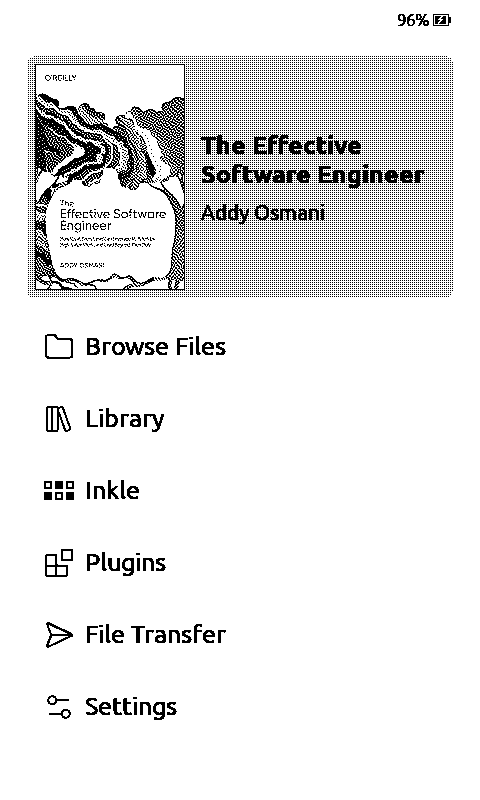
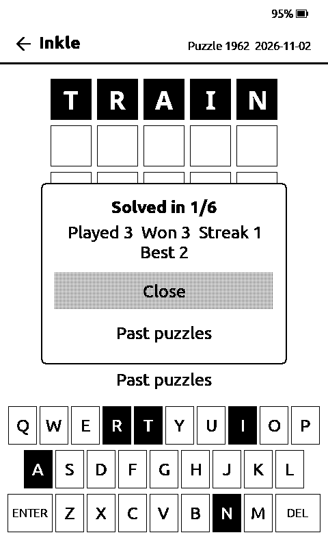
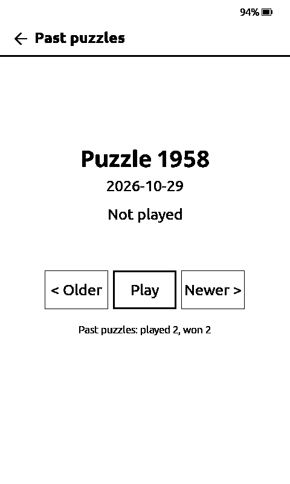

# CrossPoint + Inkle

<p align="center">
  
  
  
</p>

[CrossPoint Reader](https://github.com/crosspoint-reader/crosspoint-reader) firmware for the
**Xteink X4 Pro**, plus one thing: **Inkle**, a daily five-letter word game you play on the
e-ink screen. Everything else is stock CrossPoint, including plugins, the web file manager,
fonts, sync and the reader itself.

- Six guesses to find the day's five-letter word. Tiles show letters that are in the right
  place (filled), in the word but elsewhere (thick border), or not in the word (shaded).
- One puzzle per calendar day, chosen from a built-in list; streaks and totals are kept on
  the SD card. Works fully offline.
- Past puzzles, too: once today's is done, tap "Past puzzles" (or long-press Confirm) to pick
  any earlier day and play it. Those count in their own "played / won" pair and never touch
  the daily streak.
- Reached from the Home screen (an "Inkle" row, or the sixth tab on the Cover Grid theme).
  Touch the on-screen keyboard, or use the buttons: Left/Right and Up/Down move across the
  keys, Confirm presses one, Back leaves the game. Progress is saved after every guess.

This fork tracks CrossPoint's **stable releases** automatically: when upstream tags a new
version, a workflow merges it, builds, and publishes a matching release here. See
[How it stays current](#how-it-stays-current).

> Only the Xteink X4 Pro build is published. Do not flash it on an X3 or X4 (those are a
> different chip). Those devices should use upstream CrossPoint.

## Install

Pick one. Your books, settings and plugins on the SD card are not touched by either.

**From the SD card (no cable)**

1. Download `crosspoint-<version>-x4pro.bin` from the
   [latest release](https://github.com/burgoon/crosspoint-inkle/releases/latest).
2. Copy it to the root of the SD card as `firmware.bin`.
3. On the device: Settings → System → update from SD. Wait for the reboot.

**Over the cable**

1. Connect the X4 Pro to your computer with its magnetic cable, device on and awake.
2. `pip install esptool`, then (adjust the port):

   ```
   esptool --chip esp32s3 --port /dev/cu.usbmodem101 --baud 921600 write-flash 0x10000 crosspoint-<version>-x4pro.bin
   ```

   On Windows the port looks like `COM5`; on Linux, `/dev/ttyACM0`.

**Updates later:** Settings → Check for updates on the device looks at this repository's
releases, or repeat either method above.

## Going back to stock CrossPoint

Flash the matching `crosspoint-<version>-x4pro.bin` from
[CrossPoint's releases](https://github.com/crosspoint-reader/crosspoint-reader/releases) the
same way. The game's save file (`/.crosspoint/inkle.txt`) can be deleted or left alone.

## How it stays current

The `inkle` branch is CrossPoint's latest stable tag plus a small, fixed set of changes:

- `src/apps_local/inkle/` — the game.
- A Home-menu row and a Cover Grid tab that open it (`HomeActivity`, `CoverGridHomeUi`).
- The version string and update URL in `platformio.ini`, and a one-line override in the
  update checker so it reads this fork's releases.

`.github/workflows/inkle-sync.yml` runs daily: it looks for a newer upstream stable tag,
merges it into `inkle`, builds the X4 Pro firmware, and publishes a release tagged
`<upstream version>-inkle.<n>`. If the merge conflicts, it opens an issue instead.

## Build it yourself

```
git clone --recursive https://github.com/burgoon/crosspoint-inkle
cd crosspoint-inkle
python3.13 -m venv .venv
.venv/bin/pip install esptool https://github.com/pioarduino/platformio-core/archive/refs/tags/v6.1.19.zip
.venv/bin/pio run -e x4pro-gh_release
```

The image is at `.pio/build/x4pro-gh_release/firmware.bin`. Host tests for the game rules:

```
cmake -S test/inkle_core -B build/inkle-test && cmake --build build/inkle-test && ctest --test-dir build/inkle-test
```

Word lists are generated by `tools/inkle/gen_words.py` from
[SCOWL](http://wordlist.aspell.net/) (Kevin Atkinson), used under its permissive license;
see `tools/inkle/SCOWL-LICENSE.txt`.

## Credits and license

CrossPoint Reader by Dave Allie and contributors, and the [FreeInk SDK](https://freeink.org/),
do all the real work here; upstream's README is kept at `docs/crosspoint-readme.md`.
Everything in this repository is MIT licensed, like CrossPoint.

Inkle is an independent hobby project. It is not affiliated with, endorsed by, or connected
to The New York Times or any other word-game publisher.
